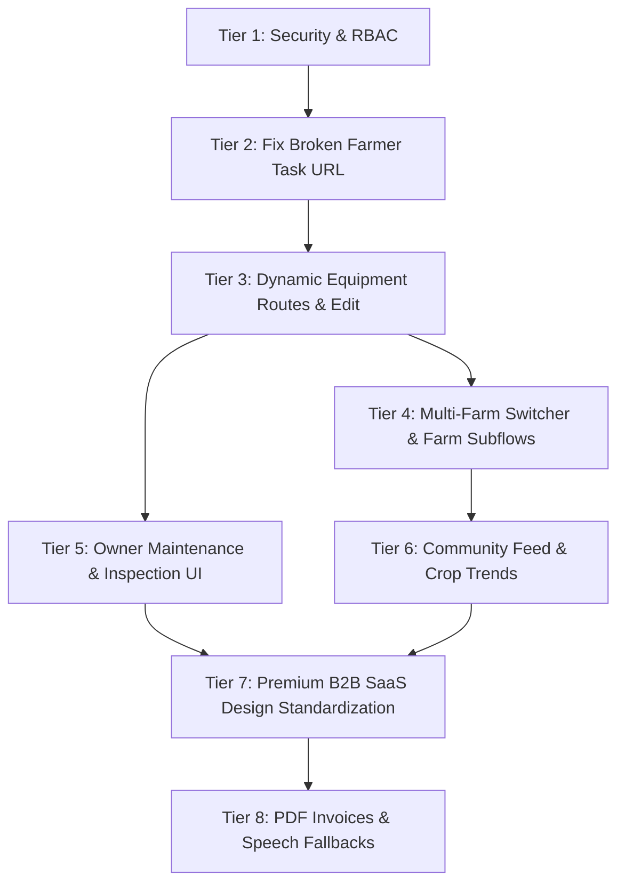

# AgroRent AI — Recommended Implementation Roadmap & Task Ordering

**Audit Date:** October 27, 2026  
**Project Root:** `D:\AgriRent_AI`  
**Purpose:** Actionable, Dependency-Aware Engineering Roadmap for Completing the Web Application

---

## 1. Roadmap Prioritization Framework

Tasks are ranked strictly in accordance with risk, stability, user impact, and engineering dependencies:
1. **Tier 1: Security, Data Integrity & Core Authentication**
2. **Tier 2: Broken Existing Features & Broken Critical User Journeys**
3. **Tier 3: Core Marketplace, Equipment & Booking Parity**
4. **Tier 4: Missing Farmer Portal Functionality**
5. **Tier 5: Missing Owner Portal Functionality**
6. **Tier 6: Missing Community & Social Farming Subsystem**
7. **Tier 7: UI Standardization, Design Tokens & Micro-Interactions**
8. **Tier 8: Secondary Enhancements & Offline Fallbacks**

---

## 2. Ranked Implementation Tasks & Dependency Map

---

### Tier 1: Security & Core Authentication (Immediate Priority)
- **Task 1.1: Verify & Harden RBAC Layout Guards across all Portals**
  - *Target Files:* `web/src/app/dashboard/layout.tsx`, `web/src/components/AuthProvider.tsx`
  - *Requirement:* Ensure Farmers cannot access Owner routes (`/dashboard/equipment/new`, `/dashboard/history`), Owners cannot access Farmer-only farm plans, and non-admins receive immediate client-side redirection away from `/dashboard/admin`.
  - *Dependency:* None.
  - *Verification:* Automated Playwright test verifying 403 / redirect on cross-role navigation.

---

### Tier 2: Fix Broken Existing Features (Critical Bug Fix)
- **Task 2.1: Repair Farmer Dashboard Task Completion API Route Mismatch**
  - *Target Files:* `web/src/app/dashboard/farmer/page.tsx`, `backend/src/routes/farms.ts`
  - *Defect:* Client calls `POST /api/farms/:farmId/operations/:opId/complete` without `/crops/:cropId`, resulting in HTTP 404.
  - *Action:*
    1. Update `farmer/page.tsx` line 184 to call `/farms/${farmId}/crops/${cropId}/operations/${showFeedbackModal}/complete`.
    2. Register backward-compatible alias route in `backend/src/routes/farms.ts` line 295.
  - *Dependency:* Tier 1.
  - *Verification:* Trigger "Complete Task" modal in web browser, verify HTTP 200 and instant timeline progression.

---

### Tier 3: Core Marketplace, Equipment & Booking Parity
- **Task 3.1: Implement Dynamic Equipment Detail Page (`/dashboard/equipment/[id]`)**
  - *Target Files:* `web/src/app/dashboard/equipment/[id]/page.tsx`
  - *Action:* Create dedicated full-page equipment view with image carousel, specifications grid, verified owner badge, interactive `EquipmentLocationMap.tsx`, customer ratings/reviews list, and embedded booking launcher.
  - *Dependency:* Tier 2.
  - *Verification:* Navigate from `/dashboard/marketplace` to `/dashboard/equipment/[id]`; verify page renders cleanly.

- **Task 3.2: Implement Dedicated Equipment Edit Page (`/dashboard/equipment/[id]/edit`)**
  - *Target Files:* `web/src/app/dashboard/equipment/[id]/edit/page.tsx`
  - *Action:* Pre-populate existing machine specifications, price per day, description, and photos; allow owner to update and toggle availability (`PUT /api/equipment/:id`); provide delete action with confirmation modal (`DELETE /api/equipment/:id`).
  - *Dependency:* Task 3.1.
  - *Verification:* Owner updates rate from ₹1200 to ₹1500; verifies updated price in fleet inventory.

- **Task 3.3: Implement Dedicated Booking Details & Lifecycle Page (`/dashboard/bookings/[id]`)**
  - *Target Files:* `web/src/app/dashboard/bookings/[id]/page.tsx`
  - *Action:* Detailed view of rental agreement, 5-stage lifecycle stepper (Pending -> Confirmed -> Dispatched -> Active -> Returned -> Completed), security deposit tracker, return inspection notes, and integrated `ChatModal.tsx` launcher.
  - *Dependency:* Task 3.1.
  - *Verification:* Advance booking from Confirmed to Dispatched; verify status update persists in database.

---

### Tier 4: Missing Farmer Portal Sub-Flows
- **Task 4.1: Multi-Farm Selector on Farmer Dashboard**
  - *Target Files:* `web/src/app/dashboard/farmer/page.tsx`
  - *Action:* Replace hardcoded `farmsRes.data[0]` with a farm switcher dropdown storing active `farmId` and `cropId`.
  - *Dependency:* Task 2.1.
  - *Verification:* Farmer with 2 farms can toggle between them and see respective timelines update.

- **Task 4.2: Crop Stage Agronomic Intelligence View (`/dashboard/stages/[stage]`)**
  - *Target Files:* `web/src/app/dashboard/stages/[stage]/page.tsx`
  - *Action:* Port `CropStageIntelligenceService` agronomic guidance to web: "What to do now", common problems, precautions, and recommended machinery categories for the active crop stage.
  - *Dependency:* Task 4.1.
  - *Verification:* Tapping a stage on the journey timeline opens the detailed agronomic guidance page.

- **Task 4.3: Completed Farm Tasks Archive (`/dashboard/tasks/completed`)**
  - *Target Files:* `web/src/app/dashboard/tasks/completed/page.tsx`
  - *Action:* Display paginated historical log of all finished operations and tasks with completion dates and farmer notes, consuming `GET /api/farms/:farmId/crops/:cropId/tasks/completed`.
  - *Dependency:* Task 4.1.
  - *Verification:* Newly completed operations appear immediately in the completed archive.

- **Task 4.4: Manual Farm Expense Logging (`/dashboard/expenses`)**
  - *Target Files:* `web/src/app/dashboard/expenses/page.tsx`
  - *Action:* Allow farmers to log non-rental farming expenses (Fertilizer, Seeds, Labour, Diesel) consuming `POST /api/farms/:id/financials/expense` with category breakdown charts.
  - *Dependency:* Task 4.1.
  - *Verification:* Submitting ₹2,500 for seeds reflects immediately on budget progress bar.

---

### Tier 5: Missing Owner Portal Functionality
- **Task 5.1: Owner Equipment Maintenance & Downtime Tracker**
  - *Target Files:* `web/src/app/dashboard/equipment/[id]/maintenance/page.tsx` (or modal)
  - *Action:* Form to log maintenance event (Oil change, repairs, scheduled servicing, cost, service provider), setting `available: false` during servicing window via `POST /api/equipment/:id/maintenance`.
  - *Dependency:* Task 3.2.
  - *Verification:* Machine flagged under maintenance is greyed out in public marketplace search.

- **Task 5.2: PDF Tax Invoice Download Trigger**
  - *Target Files:* `web/src/app/dashboard/history/page.tsx`
  - *Action:* Add "Download Invoice (PDF)" action to rental transactions connecting to `GET /api/payments/:bookingId/invoice`.
  - *Dependency:* Task 3.3.
  - *Verification:* Tapping download opens valid A4 PDF tax invoice in browser.

---

### Tier 6: Community Agrarian Social Network
- **Task 6.1: Community Discussion Feed (`/dashboard/community`)**
  - *Target Files:* `web/src/app/dashboard/community/page.tsx`
  - *Action:* Implement message feed with topic filters (Discussions, Crops & Farming, Equipment Demand, Farming Advice), search bar, and post creation form consuming `GET/POST /api/community/messages`.
  - *Dependency:* Tier 1.
  - *Verification:* Post message; verify instant appearance in feed across browser tabs via Socket.IO.

- **Task 6.2: Regional Crop Trends Analytics Tab**
  - *Target Files:* `web/src/app/dashboard/community/trends/page.tsx`
  - *Action:* Interactive bar charts displaying district-level crop distribution consuming `GET /api/community/crop-trends` and crop registration form consuming `POST /api/community/my-crops`.
  - *Dependency:* Task 6.1.
  - *Verification:* Registering Cotton crop updates regional percentage bar.

---

### Tier 7: UI Standardization, Design Tokens & Quality Polish
- **Task 7.1: Apply AgroRent Design Tokens Consistently**
  - *Target Files:* All pages in `web/src/app/dashboard/`
  - *Action:* Standardize headers, cards, and buttons to use `#163A2D` (Forest Green primary), `#16845B` (Supporting Green), `#84CC16` (Accent Lime), and `#F6F8F6` (Background). Replace all remaining random `indigo`, `amber`, and `rose` accents.
  - *Dependency:* Tiers 1–6.
  - *Verification:* Visual inspection and Playwright responsive suite rerun.

- **Task 7.2: Replace Technical Screaming-Uppercase Headings**
  - *Target Files:* Layout, admin tables, and dashboard cards.
  - *Action:* Transform raw enum labels (`CONFIRMED`, `OUT_FOR_DELIVERY`, `EMAIL_ADDRESS`) into human-readable sentence-case text (`Confirmed`, `Out for Delivery`, `Email Address`).
  - *Dependency:* Task 7.1.
  - *Verification:* 0 screaming uppercase headings in visible dashboard DOM.

---

### Tier 8: Secondary Enhancements & Offline Fallbacks
- **Task 8.1: Web Speech Recognition API Integration with Microphone Permissions**
  - *Target Files:* `web/src/app/dashboard/ai-advisor/page.tsx`
  - *Action:* Add graceful fallback when microphone permissions are denied; provide clear audio wave indicator while transcribing.
  - *Dependency:* Tier 7.
  - *Verification:* Spoken query in Chrome transcribes into the advisory chat input.
